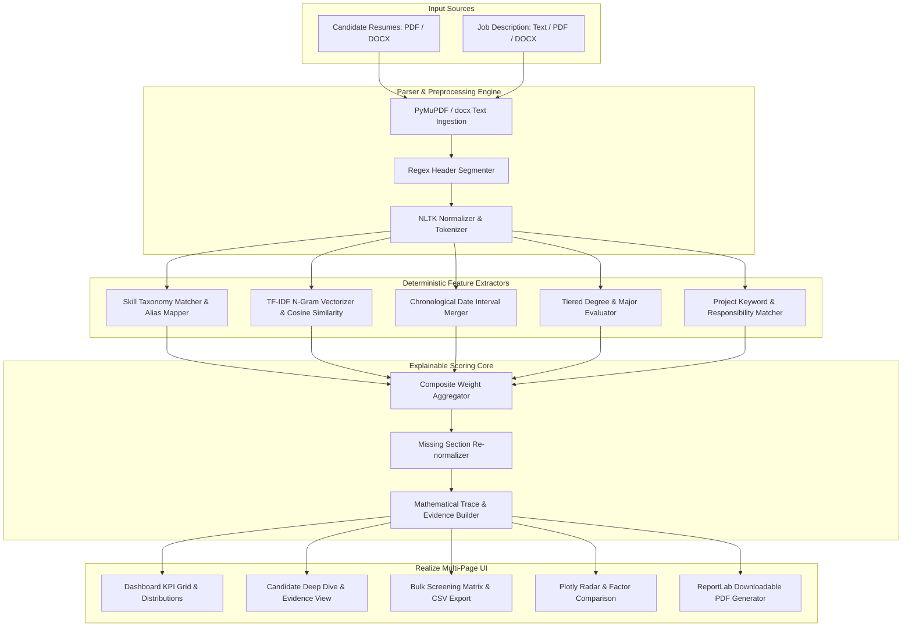
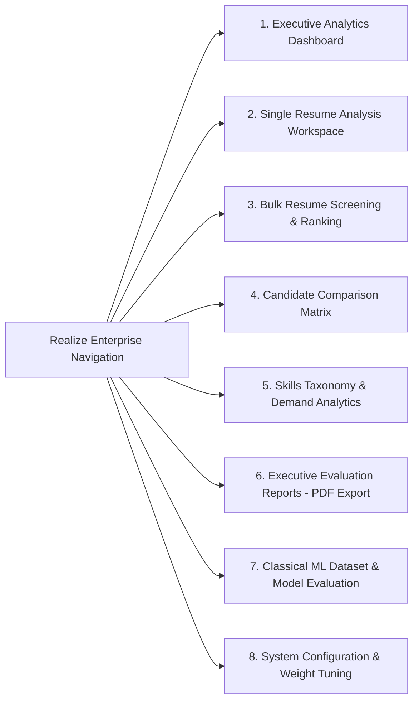

# Realize - Graphical Representations & Process Diagrams

## 1. System Pipeline Architecture



---

## 2. Chronological Date Interval Coalescing Flow

```mermaid
flowchart LR
    A[Raw Date Strings: 'Jan 2020 - Mar 2022', 'Dec 2021 - Present'] --> B[Convert to Normalized Date Intervals: [Start, End]]
    B --> C[Sort Intervals by Start Date]
    C --> D{Does Interval i Overlap with Interval i-1?}
    D -- Yes --> E[Merge Intervals: [Start_prev, max(End_prev, End_curr)]]
    D -- No --> F[Append as Distinct Tenure Interval]
    E --> G[Sum Total Elapsed Non-overlapping Months]
    F --> G
    G --> H[Convert to Total Verified Experience Years]
```

---

## 3. Dynamic Re-normalization Decision Tree

```mermaid
flowchart TD
    Start[Calculate Component Scores] --> Check{Any Component Flagged Missing?}
    Check -- No --> Normal[Apply Standard Configured Weights: Sum = 100%]
    Check -- Yes --> Renorm[Remove Missing Dimension from Active Set A]
    Renorm --> Recalc[Compute Scale Factor: 1.0 / Sum(w_active)]
    Recalc --> Scale[Scale Remaining Active Weights: w_new = w_old * Factor]
    Scale --> Warn[Flag Incomplete Assessment with Confidence Metric]
    Normal --> Finish[Emit Final Composite Score & Full Audit Trace]
    Warn --> Finish
```

---

## 4. Multi-Page Navigation Wireframe Hierarchy


